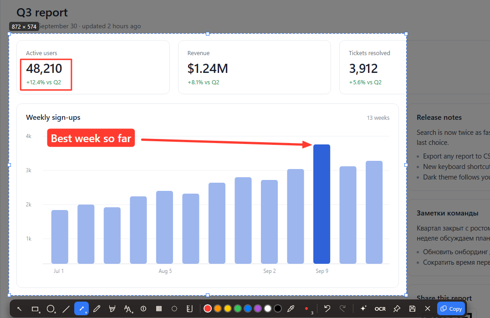
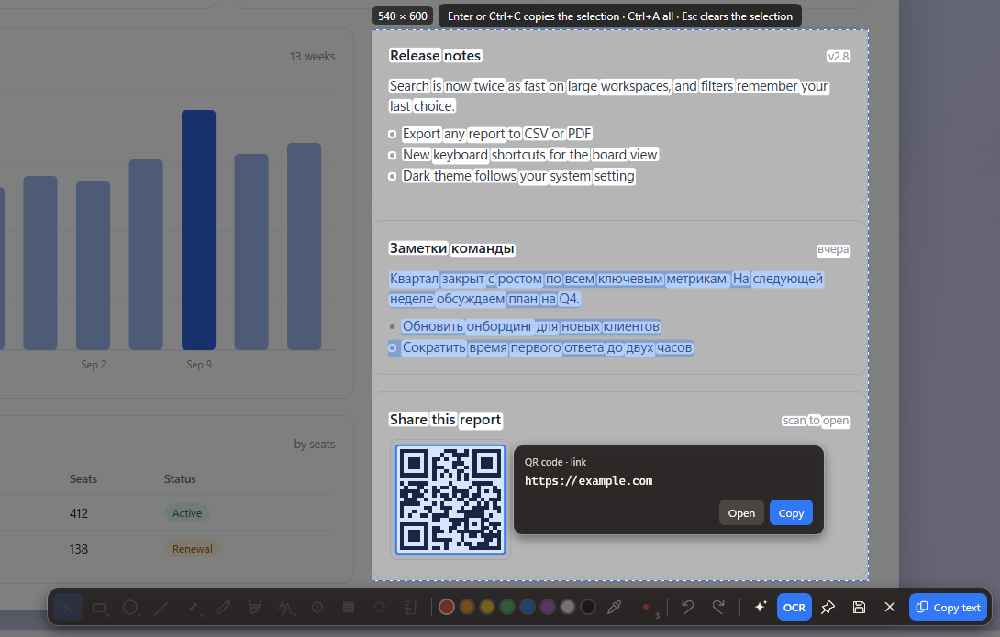
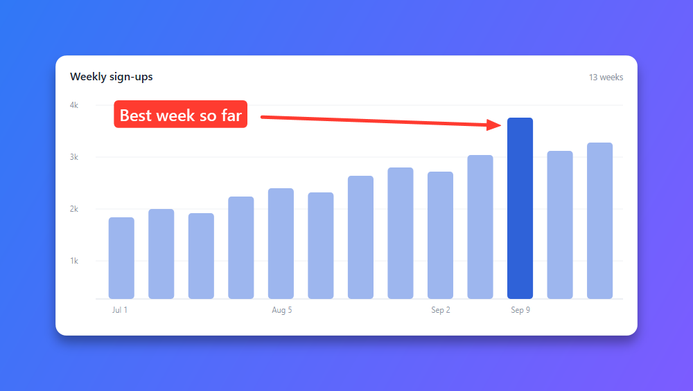

# Screeny

English | [Русский](README.ru.md)

Screeny is a screenshot tool for Windows 10 and 11. Press PrintScreen, pick a window or drag over an area, draw
arrows and notes right on the frozen screen, and press Enter. The picture is now in your clipboard. Screeny can also
read text from a screenshot, decode QR codes, pin a shot on top of other windows and keep a history you can go back
to and edit. Everything happens on your computer.

The interface comes in English, Russian, Spanish, Simplified Chinese and Japanese. Screeny uses your Windows display
language and falls back to English if it isn't one of these. You can pick another language at the top of settings
("Language") or in the first-run wizard, and open windows switch right away.



## Download

Get either version from the [releases page](https://github.com/DontIgnore/Screeny/releases/latest). Both need
Windows 10 or 11, 64-bit.

- **Installer**, `Screeny-win-Setup.exe` (about 17 MB). Installs Screeny for your user account, without admin rights,
  into `%LocalAppData%\DontIgnore.Screeny\`. It adds a Start menu shortcut and an entry in Settings > Apps, so you can
  uninstall it the usual way. If the .NET 8 Desktop Runtime is missing, the installer downloads and installs it.
- **Portable**, `Screeny-win-Portable.zip` (about 10 MB). Unzip it anywhere and run `Screeny.exe`. You need the
  [.NET 8 Desktop Runtime](https://dotnet.microsoft.com/download/dotnet/8.0) installed first (free, from Microsoft).
  The portable version updates itself too, in its own folder.

Both versions keep your settings and history in the same place, so switching from portable to the installer loses
nothing. If you are moving from an older copy, quit it first (tray icon > "Exit"). Otherwise the new copy sees it
running, asks it to take a screenshot and closes.

To uninstall, use Settings > Apps > Screeny > Uninstall, or delete the portable folder. Your settings and screenshots
stay. To remove them too, delete `%AppData%\Screeny` and `%LocalAppData%\Screeny`.

## Quick start

1. Press **PrintScreen**. The screen freezes and dims.
2. Click a window to select it, or drag to select any area. Arrow keys nudge the selection by a pixel.
3. Pick a tool on the toolbar and draw: an arrow, a box, some text.
4. Press **Enter**. The screenshot is copied to the clipboard and saved to the history.

`Esc` or a right click steps back one layer at a time, and closes the overlay at the end. A left click on the tray icon
also takes a screenshot.

If PrintScreen opens the Windows snipping tool instead, see [Other screenshot tools](#other-screenshot-tools). While
Windows holds PrintScreen and no other shortcut works, Screeny turns on `Ctrl+Alt+S` as a backup and tells you so.

## Keyboard shortcuts

**Anywhere**

| Key | Action |
|---|---|
| `PrintScreen` | Take a screenshot (the default; you can add `Win+Shift+S` and your own shortcuts in settings) |

**While selecting and drawing**

| Key | Action |
|---|---|
| Click / drag | Select the window under the cursor / select an area |
| Arrows, `Shift`+arrows | Move / resize the selection by 1 px (with `Ctrl`, by 10 px) |
| `1`…`9`, `0`, `-`, `=` | Select, rectangle, ellipse, line, arrow, pen, highlighter, text, number badge, pixelate, blur, ruler |
| Mouse wheel | Line thickness |
| `Shift` while drawing | Square or circle, lines at 45° steps |
| `Alt` while dragging | Turn off snapping for this move |
| `I` | Eyedropper: the next click picks a color from the screenshot |
| `C` (before selecting) | Copy the pixel color under the magnifier as `#RRGGBB` |
| `B` | Turn the background frame on or off |
| `Ctrl+Z` / `Ctrl+Y` | Undo / redo |
| `Delete` | Delete the selected shape |
| `Enter` | Copy and close (in settings you can make Enter only save to history) |
| `Ctrl+C` | Always copy and close, even if Enter is set to only save |
| `Ctrl+S` | Save as PNG or JPEG |
| `F3` | Pin on top of other windows |
| `Ctrl+T` | Text mode: select and copy text from the screenshot (press again to go back) |
| `Esc` / right click | Step back: current gesture, then selected shape or tool, then the selection, then close |

**Text mode**

| Key | Action |
|---|---|
| Drag from a word | Select text in reading order |
| Drag from empty space | Select only the words inside the box |
| Click / double click | A word / a line. `Shift`+click extends, `Ctrl`+click adds |
| Click a code | Show what a QR code or barcode contains |
| `Ctrl+A` | Select all text |
| `Enter`, `Ctrl+C` | Copy the selection (or all text) and close |

**Pinned screenshot**

| Key | Action |
|---|---|
| Drag | Move |
| Wheel / `Ctrl`+wheel | Zoom 20–500% / opacity |
| `Ctrl+C`, `Ctrl+S` | Copy, save |
| Right click | Menu |
| Double click / `Esc` | Close |

## Features

### Capture

- Freezes all your monitors at once, so menus and tooltips stay put while you select.
- Highlights the window under the cursor. A click takes the whole window, or the whole monitor if there is none.
- A magnifier shows pixel coordinates and the color under the cursor.
- The selection edge snaps to window edges and to sharp edges inside the screenshot, like buttons and panels.
- Several capture shortcuts at once: PrintScreen, `Win+Shift+S` instead of the Windows snipping tool, and any
  shortcuts of your own.
- The clipboard gets both PNG and DIB, so the picture pastes into chat apps and browsers as well as into Paint and
  Office.

### Markup

- Rectangle, ellipse, line, arrow, pen, highlighter, text, numbered badges, pixelate and blur.
- Shapes can have an outline, a fill, or both. Arrows come in four styles. Text can have a rounded background and
  left, center or right alignment.
- Hover over the active tool's button to see its options. Selected shapes show their options right next to them.
- Shapes snap to the edges and centers of other shapes, with thin guides while you drag.
- A ruler measures distance in screenshot pixels. It is never part of the final picture.
- Shapes can be selected, moved, recolored and deleted until you close the screenshot. Undo and redo work for
  everything.

### Text and QR codes

Press `Ctrl+T` and Screeny highlights the text it found in your screenshot. Select what you need with the mouse and
press Enter to copy it. This uses the OCR built into Windows, for every language in your Windows profile that has OCR
installed.

QR codes and barcodes (QR, Data Matrix, EAN-13/8, UPC-A, Code 128/39) are found at the same time. Click a code to see
its contents and copy them. For `http` and `https` links there is also an "Open" button. Screeny never opens a link
by itself.

**Precise OCR module (optional).** Windows OCR often misses small screen text and nicknames. You can download a
PaddleOCR module of about 30 MB that reads them much better. It is off until you ask for it: click "Download" in
settings under "Text recognition and QR", or tick the box in the first-run wizard. After that, `Ctrl+T` shows the
Windows result right away and swaps in the better one a moment later. A typical 800×400 area takes about 0.2 s and a
full 1920×1080 screen about 2 s on a fast desktop CPU. The module reads Cyrillic and Latin text. For other scripts,
like Chinese or Japanese, Screeny keeps the Windows result. The models load on first use and unload after three
minutes of idle time. On a full screen they can take up to about 1 GB of memory.



### History

- Every screenshot is saved as a PNG in the history folder, together with its markup. The history window shows
  thumbnails of recent shots. By default Screeny keeps the last 50.
- Press ✎ on a card (or `E`) to open a screenshot in the editor and keep working on it. Your edits are saved as a new
  history entry, and the original entry stays as it was.
- If you turn on "Keep originals for re-editing", Screeny also keeps a clean copy without markup, so
  old shapes can be moved and changed later. This copy contains everything you blurred or pixelated, so it is off by
  default.
- Deleting from history skips the Recycle Bin, so Screeny asks first.

### Pins

Press `F3` to pin a screenshot on top of all windows. Drag it around, zoom with the wheel, change its opacity with
`Ctrl`+wheel. A setting keeps pinned screenshots out of new captures.

### Background frame

Press `B` (or the ✨ button) to place the screenshot on a gradient background with padding, rounded corners and a soft
shadow. While the frame is on, hover over ✨ to pick one of six backgrounds, the padding, the corner radius and the shadow. The frame applies
to copying, saving, pinning and history alike. It is off by default and remembers your choice.



## Optional features

You can turn off text recognition, history, pins, the background frame, the eyedropper and the ruler, either in the
first-run wizard or in settings under "Features". A feature you turn off disappears completely: its buttons, keys, menu
items and settings are gone, and its code doesn't run. Release notes about it are hidden too.

Without history, a screenshot is only copied to the clipboard.

## Updates and privacy

Your screenshots never leave your computer. Screeny goes online for two things only:

- **Update checks.** About 30 seconds after start, and then once a day, Screeny checks
  [GitHub Releases](https://github.com/DontIgnore/Screeny/releases) for a new version. If there is one, a tray
  notification appears. Click it to read what changed and choose "Update and restart", "Later" or "Skip this
  version". One exception: if every change in the new version is about features you turned off, Screeny doesn't bother
  you. It downloads the update in the background and applies it quietly when you quit. You can check by hand from the
  tray menu ("Check for updates…") or turn checks off in settings ("Check for updates"). Turning checks off stops
  both the prompts and the quiet updates.
- **The precise OCR module**, only when you click to download it. This works even with update checks turned off.

The module is accepted only if its SHA256 matches the hash built into the app, and every file is checked again before
the models load. Recognition itself runs on your computer.

## Where your data lives

| What | Where |
|---|---|
| Settings | `%AppData%\Screeny\settings.json` |
| History | `%LocalAppData%\Screeny\History\` (you can change the folder in settings) |
| Markup and the clean original | next to each screenshot: `<name>.screeny.json`, `<name>.orig.png` (the original only if you turned it on) |
| Error log | `%LocalAppData%\Screeny\screeny.log` |
| Skipped update version | `%LocalAppData%\Screeny\update-state.json` |
| Precise OCR module | `%LocalAppData%\Screeny\Modules\` |
| The app (installer version) | `%LocalAppData%\DontIgnore.Screeny\` |
| Start with Windows | `HKCU\Software\Microsoft\Windows\CurrentVersion\Run\Screeny` |

Uninstalling removes the app, its autostart entry and the downloaded OCR module. Settings and history stay.

## Other screenshot tools

PrintScreen and `Win+Shift+S` are often taken by another screenshot app. On first run Screeny shows one screen that
lists what it found: Lightshot, ShareX, Greenshot, PicPick, Snipaste, PowerToys key remaps, and the Windows setting
that makes PrintScreen open the snipping tool. For each one you can choose to:

- close it now;
- remove it from autostart, the same way Task Manager does (you can turn it back on there);
- run its own uninstaller;
- give PrintScreen back to Screeny, if Windows has it. Windows may need you to sign out and back in for this.

Nothing changes until you press "Apply", and Screeny never deletes anything itself. Autostart entries for all
users need admin rights, and Screeny asks for them through the usual Windows prompt. The same screen lets you pick
your capture shortcuts and whether to check for updates.

You can open it again from settings or the tray menu ("Check for conflicts…"). If a new app grabs your shortcut later,
Screeny shows a notification instead of the whole wizard.

## Known limitations

- **Monitors with different scaling.** Selection stays pixel-exact, but the toolbar and magnifier may look larger or
  smaller on some monitors. Mixed-DPI setups haven't been tested by hand.
- **Mixed Cyrillic and Latin text.** Windows OCR sometimes reads Latin words in Russian text as similar Cyrillic
  letters. Decorative fonts and narrow fonts around 10 px still come out with mistakes. The precise OCR module handles
  both much better.
- **A shortcut taken by another app can't be entered in settings**, because the key press never reaches Screeny.
  Pick a different one.

## Building from source

You need Windows and the .NET 8 SDK (the exact version is pinned in `global.json`).

```powershell
dotnet build Screeny.sln
dotnet test tests/Screeny.Tests
dotnet run --project src/Screeny          # starts in the tray
```

To build an installer and a portable zip with [Velopack](https://docs.velopack.io) (its `vpk` tool is restored
locally from `.config/dotnet-tools.json`):

```powershell
powershell -File tools/pack.ps1 -Version 0.2.0   # -> releases/
```

For a plain `publish\Screeny.exe` without an installer, run `powershell -File tools/publish.ps1` (add
`-SelfContained` to include the .NET runtime). That copy doesn't update itself.

The precise OCR module is built separately with `tools/pack-ocr-module.ps1`. It needs the models, the native ONNX
Runtime package and the Visual C++ runtime; [tools/ocr-module/README.md](tools/ocr-module/README.md) explains where to
get them.

Release steps, the dev instance and its test switches are described in [docs/maintainers.md](docs/maintainers.md).

## Writing release notes

Each version has its notes in `docs/releases/<version>.md`. The update window shows them, so write for users.
Headings, lists, **bold** and `code` are supported.

If an item is about a feature people can turn off, tag it with an HTML comment (GitHub doesn't show it):

```markdown
## Text and codes <!-- feature: ocr -->
- Pin from history <!-- feature: pins -->
- Eyedropper and ruler <!-- feature: pipette, ruler -->
```

A tag on a heading covers its whole section. A tag on an item covers that item. With several ids, the item shows if
any of them is on. Feature ids are listed in `src/Screeny/Features/FeatureCatalog.cs`; `ocr-precise` marks items for
people who use the precise OCR module.

One file holds every language. A line `<!-- lang: en -->` starts the English section, `<!-- lang: ru -->` the Russian
one, and so on (`en`, `ru`, `es`, `zh-Hans`, `ja`). The update window shows the section in the interface language, then
English, then the first one. Give every section the same feature tags. More detail is in
[docs/maintainers.md](docs/maintainers.md).

## License

Copyright (C) 2026 DontIgnore

Screeny is free software: you can redistribute it and/or modify it under the terms of the GNU General Public License
as published by the Free Software Foundation, version 3. It comes with no warranty. See [LICENSE](LICENSE) for the full text.

Screeny includes third-party components under the MIT and Apache 2.0 licenses. They are listed in
[THIRD-PARTY-NOTICES.txt](src/Screeny/THIRD-PARTY-NOTICES.txt), which ships next to `Screeny.exe`. The precise OCR
module carries its own license files.
