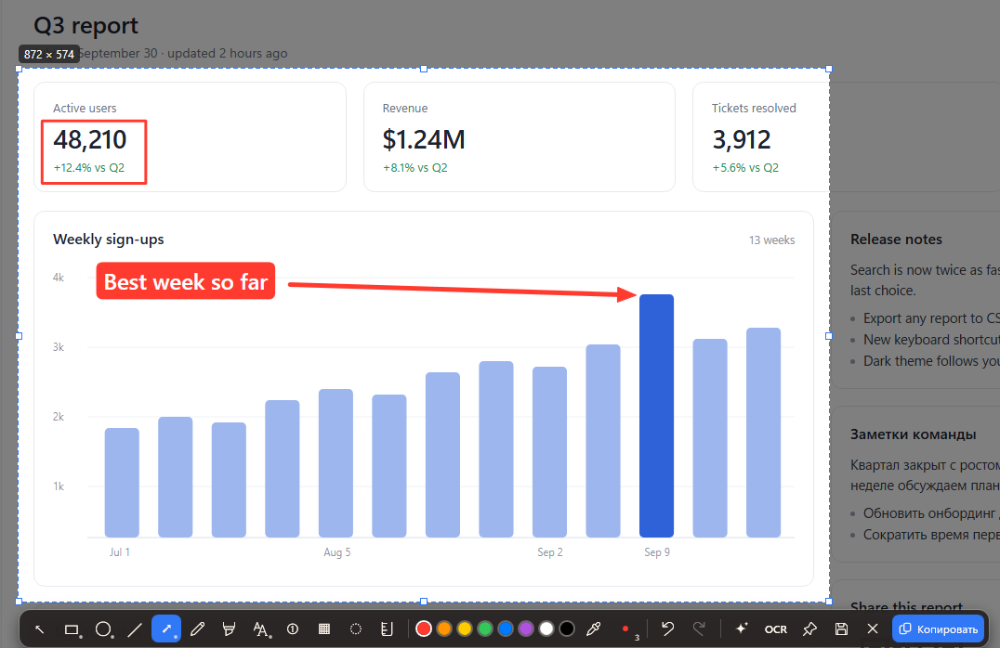
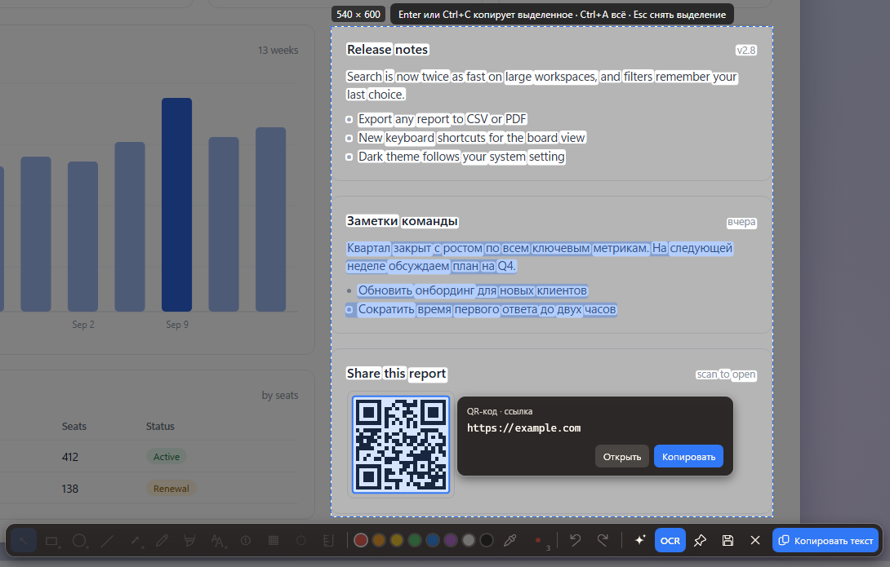

# Screeny

[English](README.md) | Русский

Screeny делает скриншоты в Windows 10 и 11. Нажмите PrintScreen, выберите окно или выделите область, нарисуйте
стрелки и подписи прямо на замершем экране и нажмите Enter. Картинка уже в буфере обмена. Ещё Screeny умеет
распознавать текст на скриншоте, читать QR-коды, закреплять скриншот поверх окон и хранить историю, к которой можно
вернуться и дорисовать. Всё это работает на вашем компьютере.

Интерфейс есть на английском, русском, испанском, китайском (упрощённом) и японском. Screeny берёт язык интерфейса
Windows, а если его нет среди этих — английский. Другой язык можно выбрать в начале настроек («Язык») или в мастере
первого запуска; открытые окна переключаются сразу.



## Скачать

Обе версии лежат на [странице релизов](https://github.com/DontIgnore/Screeny/releases/latest). Нужна Windows 10 или 11,
64-битная.

- **Установщик**, `Screeny-win-Setup.exe` (около 17 МБ). Ставит Screeny только для вашей учётной записи, права
  администратора не нужны, в `%LocalAppData%\DontIgnore.Screeny\`. Добавляет ярлык в «Пуск» и пункт в «Параметры → Приложения»,
  чтобы программу можно было удалить обычным способом. Если на компьютере ещё нет Microsoft .NET 10, установщик сам
  скачает и добавит его, и Windows может запросить разрешение.
- **Портативная версия**, `Screeny-win-Portable.zip` (около 10 МБ). Распакуйте в любую папку и запустите
  `Screeny.exe`. Заранее нужен [.NET 10 Desktop Runtime](https://dotnet.microsoft.com/download/dotnet/10.0) (бесплатно,
  с сайта Microsoft). Портативная версия тоже обновляется сама, в своей папке.

Настройки и история у обеих версий хранятся в одном месте, поэтому при переходе с портативной на установщик ничего
не теряется. Если у вас работает старая копия, сначала закройте её (иконка в трее → «Выход»). Иначе новая копия
увидит её, попросит сделать скриншот и закроется.

Удалить: «Параметры → Приложения → Screeny → Удалить» или просто удалите папку портативной версии. Настройки
и скриншоты остаются. Чтобы убрать и их, удалите `%AppData%\Screeny` и `%LocalAppData%\Screeny`.

## Быстрый старт

1. Нажмите **PrintScreen**. Экран замирает и темнеет.
2. Кликните по окну, чтобы выбрать его, или протяните мышью любую область. Стрелки сдвигают выделение на пиксель.
3. Выберите инструмент на панели и рисуйте: стрелку, рамку, текст.
4. Нажмите **Enter**. Снимок скопирован в буфер обмена и сохранён в историю.

`Esc` или правый клик отступают на шаг назад, а в конце закрывают оверлей. Клик по иконке в трее тоже делает скриншот.

Если PrintScreen открывает системные «Ножницы», смотрите [«Другие программы для скриншотов»](#другие-программы-для-скриншотов).
Пока PrintScreen занят Windows и другие сочетания не работают, Screeny включает запасное `Ctrl+Alt+S` и сообщает
об этом.

## Горячие клавиши

**Везде**

| Клавиша | Действие |
|---|---|
| `PrintScreen` | Сделать скриншот (по умолчанию; в настройках можно добавить `Win+Shift+S` и свои сочетания) |

**При выделении и рисовании**

| Клавиша | Действие |
|---|---|
| Клик / перетаскивание | Выбрать окно под курсором / выделить область |
| Стрелки, `Shift`+стрелки | Сдвинуть / изменить размер выделения на 1 px (с `Ctrl` — на 10 px) |
| `1`…`9`, `0`, `-`, `=` | Выбор, прямоугольник, эллипс, линия, стрелка, карандаш, маркер, текст, метка с номером, пикселизация, размытие, линейка |
| Колесо мыши | Толщина линии |
| `Shift` при рисовании | Квадрат или круг, линии с шагом 45° |
| `Alt` при перетаскивании | Без прилипания на это движение |
| `I` | Пипетка: следующий клик берёт цвет со скриншота |
| `C` (до выделения) | Скопировать цвет пикселя под лупой как `#RRGGBB` |
| `B` | Включить или выключить оформление |
| `Ctrl+Z` / `Ctrl+Y` | Отменить / повторить |
| `Delete` | Удалить выбранную фигуру |
| `Enter` | Скопировать и закрыть (в настройках можно сделать, чтобы Enter только сохранял в историю) |
| `Ctrl+C` | Всегда скопировать и закрыть, даже если Enter только сохраняет |
| `Ctrl+S` | Сохранить как PNG или JPEG |
| `F3` | Закрепить поверх окон |
| `Ctrl+T` | Режим текста: выделить и скопировать текст со скриншота (ещё раз — обратно) |
| `Esc` / правый клик | Шаг назад: текущий жест, затем выбранная фигура или инструмент, затем выделение, затем закрыть |

**Режим текста**

| Клавиша | Действие |
|---|---|
| Тянуть от слова | Выделить текст по порядку чтения |
| Тянуть с пустого места | Выделить только слова внутри рамки |
| Клик / двойной клик | Слово / строка. `Shift`+клик расширяет, `Ctrl`+клик добавляет |
| Клик по коду | Показать, что внутри QR-кода или штрихкода |
| `Ctrl+A` | Выделить весь текст |
| `Enter`, `Ctrl+C` | Скопировать выделенное (или весь текст) и закрыть |

**Закреплённый скриншот**

| Клавиша | Действие |
|---|---|
| Перетаскивание | Переместить |
| Колесо / `Ctrl`+колесо | Масштаб 20–500 % / прозрачность |
| `Ctrl+C`, `Ctrl+S` | Копировать, сохранить |
| Правый клик | Меню |
| Двойной клик / `Esc` | Закрыть |

## Возможности

### Снимок

- Замораживает сразу все мониторы, так что меню и подсказки никуда не денутся, пока вы выделяете.
- Подсвечивает окно под курсором. Клик берёт окно целиком, а если окна нет — весь монитор.
- Лупа показывает координаты и цвет пикселя под курсором.
- Край выделения прилипает к краям окон и к чётким границам внутри скриншота, например к кнопкам и панелям.
- Несколько хоткеев скриншота сразу: PrintScreen, `Win+Shift+S` вместо системных «Ножниц» и любые свои сочетания.
- В буфер обмена кладутся и PNG, и DIB, поэтому картинка вставляется и в мессенджеры с браузерами, и в Paint с Office.

### Пометки

- Прямоугольник, эллипс, линия, стрелка, карандаш, маркер, текст, нумерованные метки, пикселизация и размытие.
- У фигур может быть обводка, заливка или и то и другое. Стрелки бывают четырёх видов. У текста может быть
  скруглённая подложка и выравнивание по левому краю, центру или правому краю.
- Наведите курсор на кнопку активного инструмента, чтобы увидеть его параметры. У выбранной фигуры параметры
  появляются рядом с ней.
- Фигуры прилипают к краям и центрам других фигур, пока вы их тянете, видны тонкие направляющие.
- Линейка меряет расстояние в пикселях скриншота. В готовую картинку она не попадает.
- Пока скриншот открыт, фигуры можно выбрать, сдвинуть, перекрасить и удалить. Отмена и повтор работают для всего.

### Текст и QR-коды

Нажмите `Ctrl+T`, и Screeny подсветит найденный на скриншоте текст. Выделите нужное мышью и нажмите Enter, чтобы
скопировать. Работает встроенное распознавание Windows, на всех языках вашего профиля Windows, для которых оно
установлено.

QR-коды и штрихкоды (QR, Data Matrix, EAN-13/8, UPC-A, Code 128/39) ищутся одновременно с текстом. Кликните по коду,
чтобы увидеть и скопировать содержимое. Для ссылок `http` и `https` есть ещё кнопка «Открыть». Сам Screeny ссылки
никогда не открывает.

**Модуль точного распознавания (по желанию).** Windows часто не видит мелкий экранный текст и ники. Можно скачать
модуль PaddleOCR размером около 30 МБ, который читает их намного лучше. Пока вы сами не попросите, он не скачивается:
нажмите «Скачать» в настройках под «Распознаванием текста и QR» или отметьте галочку в мастере первого запуска. После
этого `Ctrl+T` сразу показывает результат Windows, а через мгновение подменяет его более точным. Обычная область
800×400 распознаётся примерно за 0,2 с, полный экран 1920×1080 — примерно за 2 с на быстром настольном процессоре.
Модуль читает кириллицу и латиницу. Для других письменностей, например китайской или японской, остаётся результат
Windows. Модели загружаются при первом использовании и выгружаются через три минуты простоя. На полном экране они
могут занимать до 1 ГБ памяти.



### История

- Каждый скриншот сохраняется в папку истории как PNG вместе со своими пометками. Окно истории показывает миниатюры
  последних скриншотов. По умолчанию Screeny хранит последние 50.
- Кнопка ✎ на карточке (или `E`) открывает скриншот в редакторе, чтобы продолжить работу. Изменения сохраняются новой
  записью истории, а исходная остаётся как была.
- Если включить «Хранить оригиналы для повторного редактирования», Screeny сохраняет ещё и чистую копию без пометок,
  и старые фигуры потом можно двигать и менять. В этой копии видно всё, что вы размыли или пикселизировали, поэтому
  по умолчанию настройка выключена.
- Удаление из истории идёт мимо корзины, поэтому Screeny сначала спрашивает.

### Закрепление

`F3` закрепляет скриншот поверх всех окон. Его можно перетаскивать, масштабировать колесом и делать прозрачнее
через `Ctrl`+колесо. Отдельная настройка не даёт закреплённым скриншотам попадать в новые.

### Оформление

`B` (или кнопка ✨) кладёт скриншот на градиентный фон с отступом, скруглёнными углами и мягкой тенью. Когда
оформление включено, наведите курсор на ✨, чтобы выбрать один из шести фонов, отступ, скругление и тень. Оформление одинаково применяется к
копированию, сохранению, закреплению и истории. По умолчанию оно выключено и запоминает ваш выбор.


## Отключаемые функции

Распознавание текста, историю, закрепление, оформление, пипетку и линейку можно выключить в мастере первого запуска
или в настройках, в разделе «Функции». Выключенная функция пропадает целиком: её кнопок, клавиш, пунктов меню
и настроек больше нет, а её код не запускается. Пункты списка изменений о ней тоже не показываются.

Без истории скриншот только копируется в буфер обмена.

## Обновления и приватность

Скриншоты никогда не покидают ваш компьютер. В сеть Screeny ходит только в трёх случаях:

- **Проверка обновлений.** Примерно через 30 секунд после запуска и затем раз в сутки Screeny проверяет
  [GitHub Releases](https://github.com/DontIgnore/Screeny/releases). Если есть новая версия, в трее появляется
  уведомление. Кликните по нему, прочитайте, что изменилось, и выберите «Обновить и перезапустить», «Позже» или
  «Пропустить эту версию». Одно исключение: если все изменения новой версии касаются выключенных вами функций,
  Screeny вас не отвлекает. Он скачивает обновление в фоне и тихо ставит его, когда вы выходите из программы.
  Проверить вручную можно из меню трея («Проверить обновления…»), выключить проверку — в настройках
  («Проверять обновления»). Выключенная проверка отменяет и уведомления, и тихие обновления.
- **Модуль точного распознавания**, только когда вы сами нажмёте «Скачать». Это работает и при выключенной проверке
  обновлений.
- **Отчёт, который вы отправляете сами**, через «Сообщить об ошибке…» или «Предложить улучшение…». Он уходит на
  screeny.page вместе с тем, что вы написали, а для ошибки ещё и с техническими подробностями: версии, язык
  интерфейса, масштаб экрана, число мониторов и последние строки журнала ошибок, из которых убрано имя пользователя.
  Их можно посмотреть перед отправкой или выключить. Скриншоты не прикладываются никогда.

Модуль принимается, только если его SHA256 совпадает с хешем, зашитым в приложение, а перед загрузкой моделей каждый
файл проверяется снова. Само распознавание идёт на вашем компьютере.

## Где лежат данные

| Что | Где |
|---|---|
| Настройки | `%AppData%\Screeny\settings.json` |
| История | `%LocalAppData%\Screeny\History\` (папку можно сменить в настройках) |
| Пометки и чистый оригинал | рядом с каждым скриншотом: `<имя>.screeny.json`, `<имя>.orig.png` (оригинал — только если вы его включили) |
| Журнал ошибок | `%LocalAppData%\Screeny\screeny.log` |
| Пропущенная версия обновления | `%LocalAppData%\Screeny\update-state.json` |
| Модуль точного распознавания | `%LocalAppData%\Screeny\Modules\` |
| Программа (версия с установщиком) | `%LocalAppData%\DontIgnore.Screeny\` |
| Автозапуск | `HKCU\Software\Microsoft\Windows\CurrentVersion\Run\Screeny` |

При удалении стираются программа, её запись автозапуска и скачанный модуль распознавания. Настройки и история
остаются.

## Другие программы для скриншотов

PrintScreen и `Win+Shift+S` часто уже заняты другой программой для скриншотов. При первом запуске Screeny показывает один
экран со всем, что нашёл: Lightshot, ShareX, Greenshot, PicPick, Snipaste, переназначения клавиш в PowerToys
и настройку Windows, из-за которой PrintScreen открывает «Ножницы». Для каждой находки можно:

- закрыть программу сейчас;
- убрать её из автозапуска так же, как это делает Диспетчер задач (там же её можно включить обратно);
- запустить её собственный деинсталлятор;
- вернуть PrintScreen Screeny, если его держит Windows. Для этого Windows может понадобиться выйти из системы
  и войти снова.

Пока вы не нажмёте «Применить», ничего не меняется, а сам Screeny никогда ничего не удаляет. Автозапуск для всех
пользователей требует прав администратора, и Screeny попросит их через обычный запрос Windows. На этом же экране
можно выбрать хоткеи скриншота и включить или выключить проверку обновлений.

Открыть его снова можно в настройках или в меню трея («Проверить конфликты…»). Если позже другая программа займёт
ваш хоткей, Screeny покажет уведомление, а не весь мастер.

## Известные ограничения

- **Мониторы с разным масштабом.** Выделение остаётся точным до пикселя, но на некоторых мониторах панель
  инструментов и лупа могут выглядеть крупнее или мельче. Вручную такие конфигурации не проверялись.
- **Смесь кириллицы и латиницы.** Распознавание Windows иногда читает латинские слова в русском тексте как похожие
  кириллические буквы. Декоративные и узкие шрифты около 10 px всё ещё читаются с ошибками. Модуль точного
  распознавания справляется с этим намного лучше.
- **Сочетание, занятое другой программой, нельзя ввести в настройках**: нажатие просто не доходит до Screeny.
  Выберите другое.

## Отзывы и участие

Нашли ошибку или есть идея? Выберите «Сообщить об ошибке…» или «Предложить улучшение…» в меню трея (они есть и в
настройках, в разделе «О программе»). Аккаунт не нужен. Отчёты читаются, прежде чем что-либо станет публичным;
удачные становятся задачами на GitHub или попадают в [план развития](https://screeny.page/roadmap). Если удобнее
написать на GitHub самому, в том же окне есть ссылка.

Хотите помочь с кодом, переводом или документацией? Начните с [CONTRIBUTING.md](CONTRIBUTING.md). О проблемах
безопасности, пожалуйста, сообщайте не публично, а как описано в [SECURITY.md](SECURITY.md).

## Сборка из исходников

Нужны Windows и .NET 10 SDK (точная версия закреплена в `global.json`).

```powershell
dotnet build Screeny.sln
dotnet test tests/Screeny.Tests
dotnet run --project src/Screeny          # уходит в трей
```

Установщик и портативный zip собираются [Velopack](https://docs.velopack.io) (его утилита `vpk` ставится локально
из `.config/dotnet-tools.json`):

```powershell
powershell -File tools/pack.ps1 -Version 0.2.0   # -> releases/
```

Чтобы получить просто `publish\Screeny.exe` без установщика, запустите `powershell -File tools/publish.ps1` (с ключом
`-SelfContained` рантайм .NET войдёт в exe). Такая копия сама не обновляется.

Модуль точного распознавания собирается отдельно, скриптом `tools/pack-ocr-module.ps1`. Ему нужны модели, нативный
пакет ONNX Runtime и рантайм Visual C++; где их взять, написано в [tools/ocr-module/README.md](tools/ocr-module/README.md)
(на английском).

Как выпустить релиз, как устроен тестовый экземпляр и его ключи — в [docs/maintainers.md](docs/maintainers.md)
(на английском).

## Как писать список изменений

У каждой версии есть свой список изменений в `docs/releases/<версия>.md`. Его показывает окно обновления, поэтому
пишите для пользователей. Поддерживаются заголовки, списки, **жирный** и `код`.

Если пункт касается функции, которую можно выключить, отметьте его HTML-комментарием (на GitHub он не виден):

```markdown
## Текст и коды <!-- feature: ocr -->
- Закрепление из истории <!-- feature: pins -->
- Пипетка и линейка <!-- feature: pipette, ruler -->
```

Метка у заголовка действует на весь его раздел, метка у пункта — на этот пункт. Если id несколько, пункт
показывается, когда включена хотя бы одна из функций. Id функций перечислены в
`src/Screeny/Features/FeatureCatalog.cs`; `ocr-precise` отмечает пункты для тех, кто пользуется модулем точного
распознавания.

Все языки — в одном файле. Строка `<!-- lang: ru -->` начинает русский раздел, `<!-- lang: en -->` — английский и так
далее (`en`, `ru`, `es`, `zh-Hans`, `ja`). Окно обновления показывает раздел на языке интерфейса, иначе английский,
иначе первый. Метки функций во всех разделах должны быть одинаковыми. Подробнее — в
[docs/maintainers.md](docs/maintainers.md).

## Лицензия

Copyright (C) 2026 DontIgnore

Screeny — свободная программа: её можно распространять и изменять на условиях GNU General Public License версии 3,
опубликованной Free Software Foundation. Никаких гарантий не предоставляется. Полный текст лицензии — в файле
[LICENSE](LICENSE).

В Screeny входят сторонние компоненты под лицензиями MIT и Apache 2.0. Они перечислены в
[THIRD-PARTY-NOTICES.txt](src/Screeny/THIRD-PARTY-NOTICES.txt), который лежит рядом со `Screeny.exe`. У модуля точного
распознавания свои файлы лицензий.
